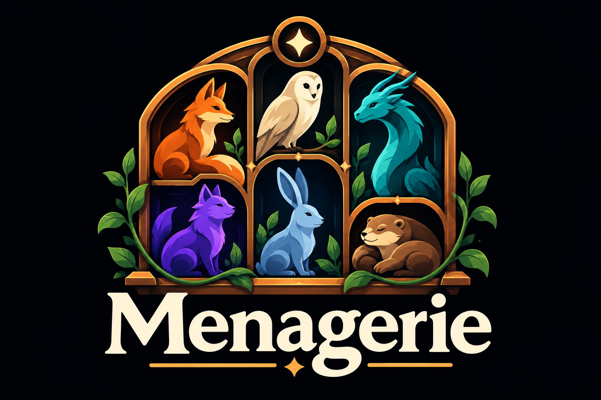

<p align="center"></p>

# Menagerie

**Your models. One home. One endpoint.**

Download models, install inference engines, and run single- or multi-model
deployments from a local dashboard. Connect clients through an OpenAI-compatible
streaming gateway or the bundled OpenCode discovery plugin.

## Install

For native Windows 11 x64, use the [Windows installer](docs/windows.md).
Windows hardware acceptance is separate from the automated packaging checks.

On Linux, download and inspect the release installer,
then run it to install the application in your user account:

```sh
curl -fLSs https://raw.githubusercontent.com/dmyoung9/menagerie/main/install.sh -o install.sh
bash install.sh
```

This requires publicly accessible release assets and internet access. To install
a downloaded wheel, use `bash install.sh --wheel /path/to/menagerie.whl` instead.
See [installation and recovery](docs/installation.md) for prerequisites and options.

The installer supplies an isolated Python environment and dependencies, then
offers a background user service, OpenCode plugin installation, and opening the
dashboard. Use `--yes` for unattended installation; optional actions require
`--service`, `--plugin`, or `--open`. No sudo or shell startup-file changes.

Run `~/.local/bin/menagerie serve`, or use the optional service. Keep the
terminal open for foreground operation; press Ctrl+C to stop. Open
**[127.0.0.1:8017](http://127.0.0.1:8017)**.

## Your first model

Open **Overview → Get your first response** for an engine/model checklist and a
small starter-model option. After saving and loading a deployment, send a test
prompt there without installing a separate client. Existing local models work too.

1. **Models → Discover:** search Hugging Face, choose a variant, and download.
   **+ Add from File** also accepts existing local GGUF files or safetensors folders.
2. Create a deployment and add the model. Install an engine from its configuration
   or **Settings → Engines**: llama.cpp for GGUF, vLLM for supported safetensors,
   or the Prism build for applicable ternary artifacts. Unknown models allow manual selection.
3. Choose context, concurrency, and residency; save and load. Settings use model
   metadata and memory estimates. CPU/RAM offload is an explicit, slower option.
   External memory use can still cause a launch to fail.
4. Send a request using the deployment's API alias:

```sh
curl http://127.0.0.1:8001/v1/chat/completions \
  -H 'Content-Type: application/json' \
  -d '{"model":"my-model","messages":[{"role":"user","content":"Hello!"}],"stream":true}'
```

## OpenCode

```sh
menagerie plugin install
```

Restart the owning OpenCode server. The plugin discovers deployment aliases and
capabilities without replacing unrelated client configuration. See
[OpenCode setup](docs/opencode.md).

## Operations and support

For a persistent container deployment, see [Unraid and containers](docs/unraid.md).
The initial image is Linux x86_64; target-host hardware acceptance is separate.

`menagerie doctor`, `status`, `backup`, and `--help` provide diagnostics and
operations. Re-running the installer upgrades in place and retains the previous
release; `bash install.sh --rollback` switches back to it. Engine updates install
alongside existing versions; choose the new version in a deployment before
removing its predecessor.

This is a single-user local application. NVIDIA is the GPU telemetry path;
drivers remain a host prerequisite. Windows hardware, WSL, and cross-distribution acceptance
are pending. See [installation and recovery](docs/installation.md),
[operations](docs/operations.md), and [release validation](docs/release-validation.md)
for safety boundaries and release requirements.

## Documentation

- [Model capabilities and reasoning](docs/model-capabilities.md)
- [Multi-model deployments](docs/multi-model-deployments.md)
- [Editing deployments](docs/forms.md)
- [Contributor guide](docs/development.md), [testing policy](docs/testing.md),
  and [release checklist](docs/release-validation.md)

## License

Menagerie is licensed under the **GNU Affero General Public License v3.0 or later (AGPL-3.0-or-later)**. See the [LICENSE](LICENSE) file for details.
